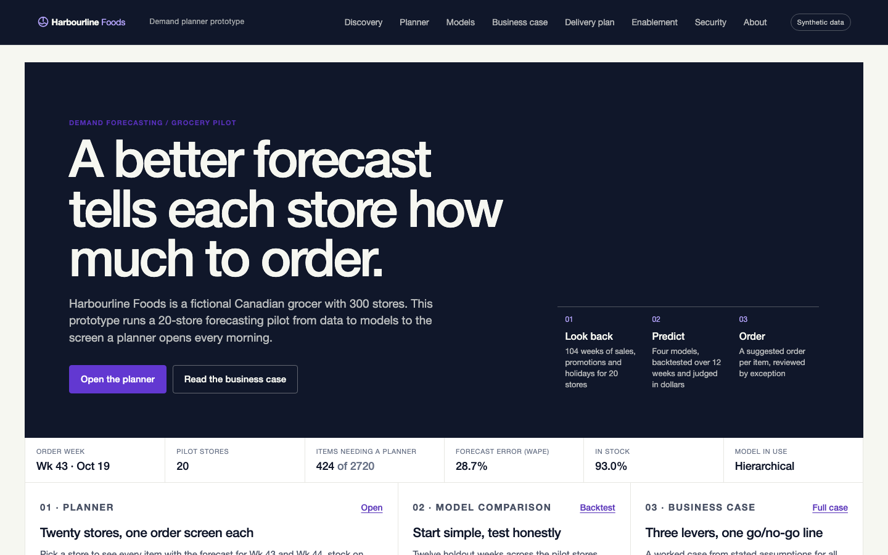
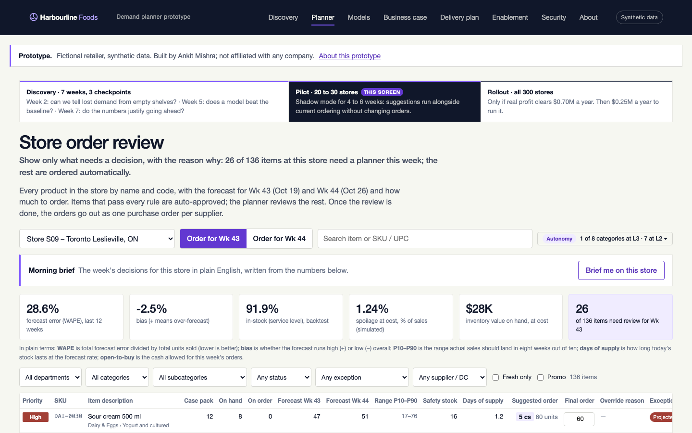
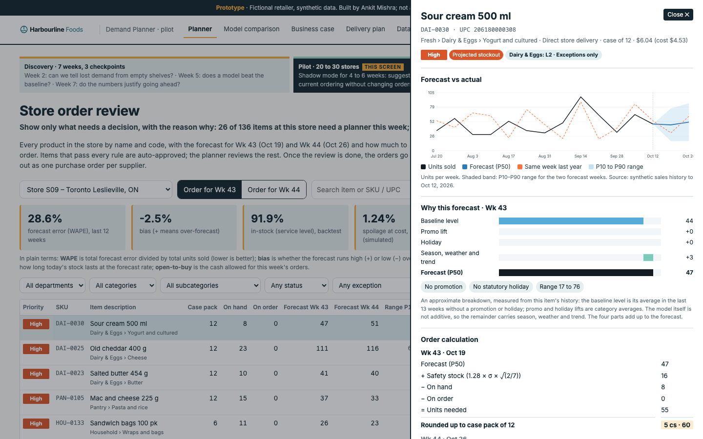
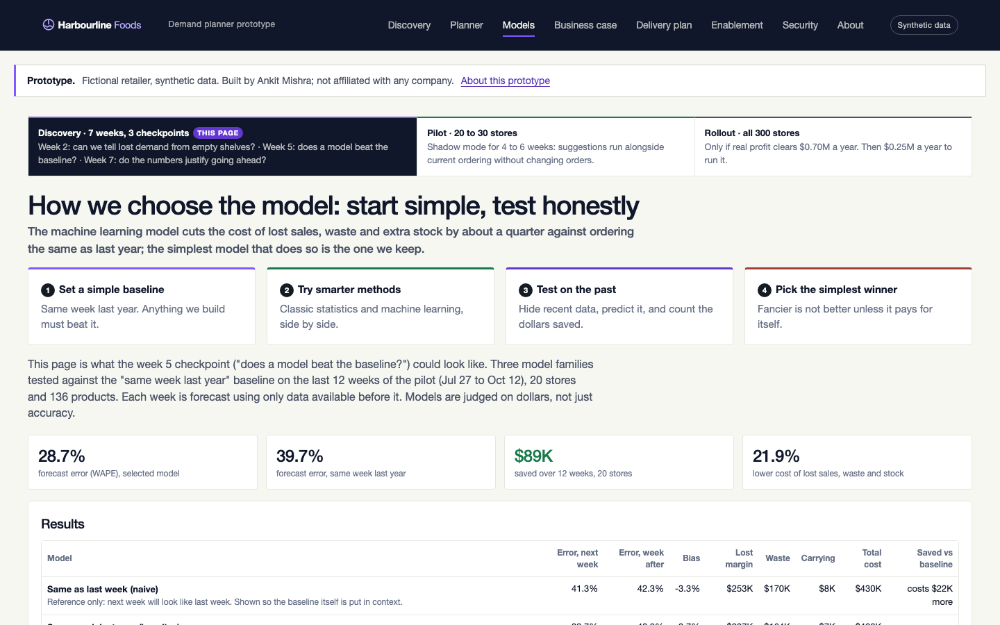
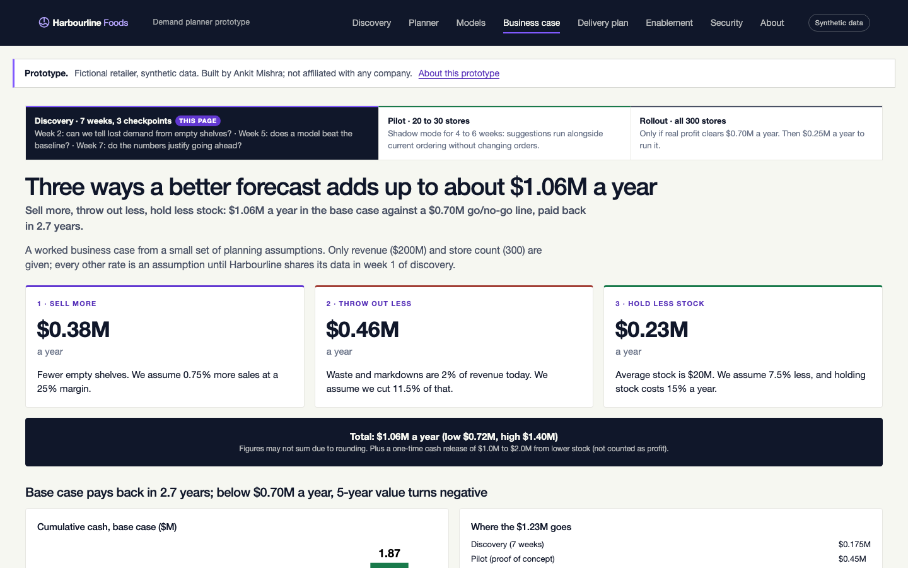
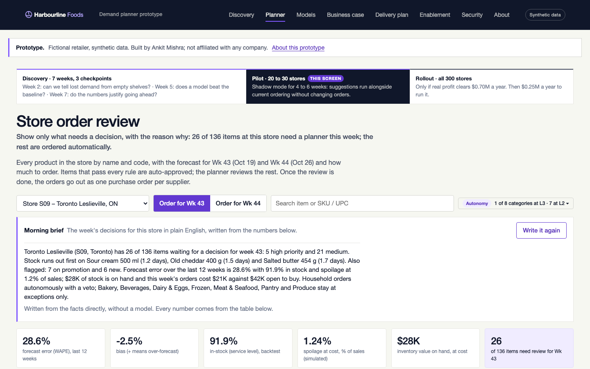
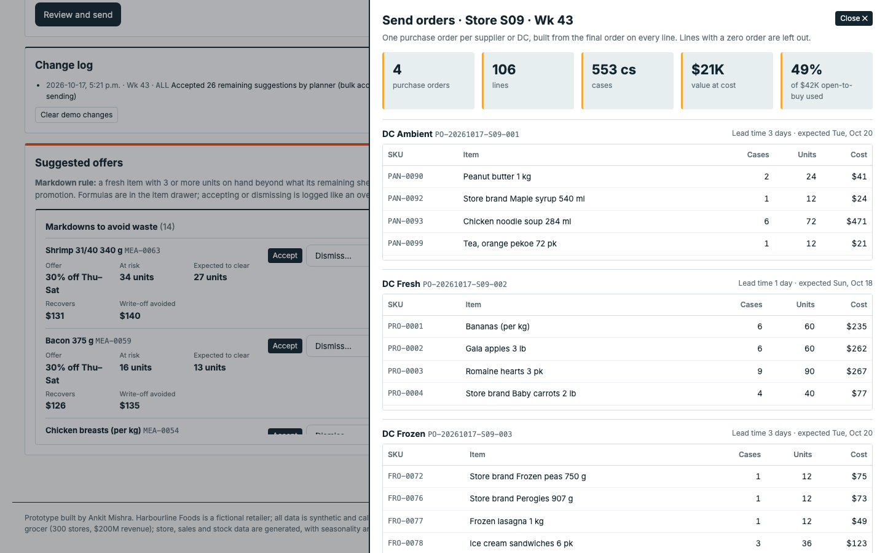
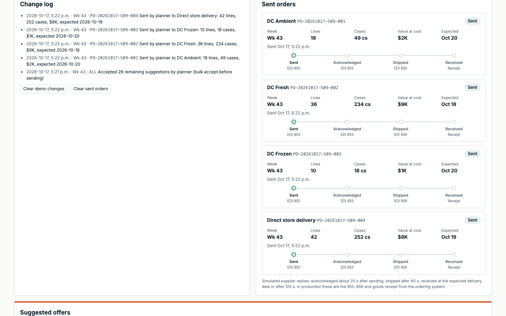
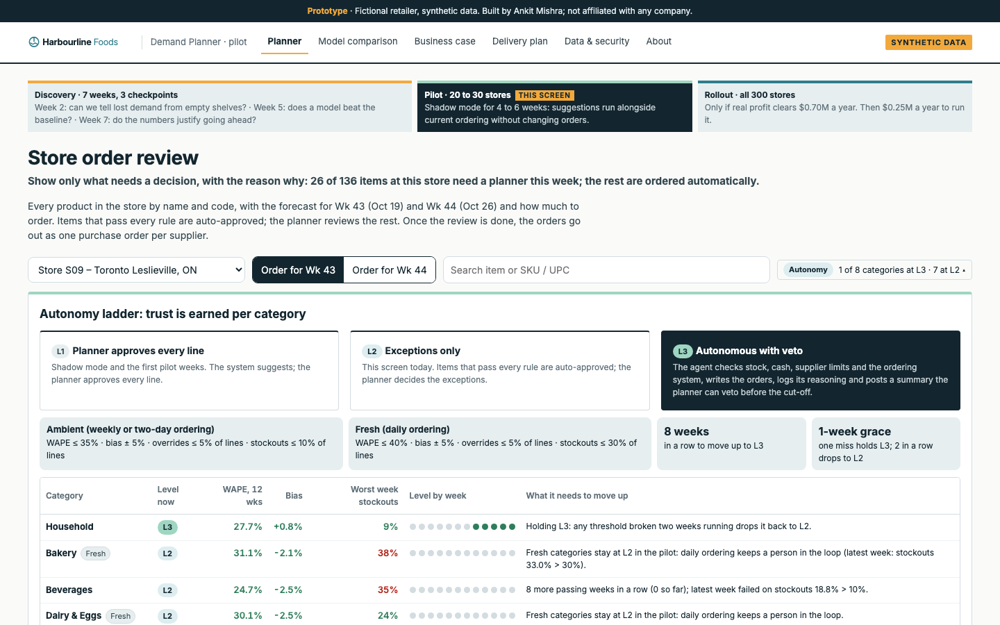

# Harbourline Foods demand planner

> Prototype built by Ankit Mishra. Harbourline Foods is a fictional retailer; all data is synthetic and calibrated to public Statistics Canada series. Not affiliated with, or built for, any company.

**Live demo:** https://harbourline-demand-planner.vercel.app (no sign-in; nothing is stored server-side, so what you do in the planner stays in your browser).

A better forecast tells each store how much to order. This repository is a working, end-to-end prototype of a grocery demand-forecasting pilot: a data pipeline, four forecasting models backtested in dollars, a store order screen that planners review by exception, a simulated order-to-supplier loop, an autonomy ladder that each product category earns from evidence, a worked business case and a seven-week delivery plan. It runs for a fictional mid-sized Canadian grocer, Harbourline Foods (300 stores, $200M revenue), on a 20-store pilot.



| Store order review | Item drawer | Model comparison | Business case |
|---|---|---|---|
|  |  |  |  |

Phone width: [landing](docs/screenshots/landing-mobile.png) · [discovery](docs/screenshots/discovery-mobile.png) · [planner](docs/screenshots/planner-mobile.png) · [brief](docs/screenshots/planner-brief-mobile.png) · [handoff](docs/screenshots/handoff-mobile.png) · [enablement](docs/screenshots/enablement-mobile.png) · [how it was built](docs/screenshots/how-it-was-built-mobile.png) · [drawer](docs/screenshots/planner-drawer-mobile.png) · [models](docs/screenshots/models-mobile.png) · [business case](docs/screenshots/business-case-mobile.png) · [delivery plan](docs/screenshots/plan-mobile.png) · [security](docs/screenshots/security-mobile.png) · [about](docs/screenshots/about-mobile.png)

## Contents

- [What it does](#what-it-does)
- [Use cases](#use-cases)
- [Pages](#pages)
- [The morning brief (Claude)](#the-morning-brief-claude)
- [Presenting the demo in five minutes](#presenting-the-demo-in-five-minutes)
- [Results](#results-12-week-holdout-20-stores--136-products-synthetic-data)
- [Business case](#how-it-maps-to-the-business-case)
- [The data](#the-data)
- [The models](#the-models-pipelinetrain_backtestpy)
- [Review rules and thresholds](#review-rules-and-thresholds-pipelineexportpy)
- [After approval: sending orders and earning autonomy](#after-approval-sending-orders-and-earning-autonomy)
- [How it is built](#how-it-is-built)
- [Run it locally](#run-it-locally)
- [Deliberate simplifications](#deliberate-simplifications) and [Limitations](#limitations)
- [What a real engagement would add](#what-a-real-engagement-would-add)

## What it does

1. **Look back.** 104 weeks of weekly sales, promotions, holidays and weather for 20 pilot stores and 136 products, generated with seasonality and food-price inflation calibrated to public Statistics Canada series.
2. **Predict.** A "same week last year" baseline, a classic time series model, gradient-boosted machine learning and hierarchical reconciliation, tested on a 12-week holdout and judged on the dollars they save (lost margin, waste, carrying cost), not only on error.
3. **Order.** A store order screen with the forecast for next week and the week after, a P10 to P90 range, stock on hand and on order, and a suggested order rounded to the case pack. Items that pass every rule are approved automatically; planners decide the exceptions. Approved orders go out as one purchase order per supplier, suppliers acknowledge and ship (simulated), and each category earns more autonomy as its evidence accumulates.
4. **Decide.** A business case from stated assumptions ($1.06M a year in the base case against a $0.70M go/no-go line, payback 2.7 years) and a seven-week discovery plan with three checkpoints where the work stops if the numbers do not clear.

## Use cases

The prototype is a complete reference implementation of a "prove it, then scale it" AI pilot. It is useful to several kinds of reader; start where your question is.

### A retailer or grocer weighing AI-assisted replenishment

You want to know what the end state looks like for your planners before you commit to a vendor or a build. Open the [planner](https://harbourline-demand-planner.vercel.app/planner/), pick a store, and work a week: accept a suggestion, override another with a reason, send the purchase orders, watch the supplier replies, and open the autonomy ladder to see what a category has to prove before the system orders on its own. The [Data & security](https://harbourline-demand-planner.vercel.app/security/) page lists what your IT and data owners would sign off at weeks 5 and 7, and the [Delivery plan](https://harbourline-demand-planner.vercel.app/plan/) shows what you would need to provide in week 1.

### An AI consultancy or strategy team running discovery to pilot

Every page maps to an engagement deliverable. Discovery (7 weeks): the value tree and three checkpoints (week 2 lost demand, week 5 model beats baseline, week 7 business case) are on the Delivery plan; the week 5 deliverable is the [Model comparison](https://harbourline-demand-planner.vercel.app/models/), and the week 7 deliverable is the [Business case](https://harbourline-demand-planner.vercel.app/business-case/). Pilot (20 to 30 stores, shadow mode): the planner screen. Rollout: the autonomy ladder and the integration loop. The six-risk table, the owner column and the "a failed checkpoint is a result, not a failure" rule are the governance scaffolding a client sponsor expects to see. Reuse the structure; swap in the client's data in week 1.

### An enterprise AI enablement or transformation lead

Adoption is designed in, not bolted on: review by exception so planners see only what needs a decision; a reason code on every override, logged and visible, so the model learns from the people using it; an autonomy ladder (L1 approve every line, L2 exceptions only, L3 autonomous with veto) with thresholds set per category class, so trust is earned with evidence and can be lost again; and a named, scoped service account for anything the system writes back to the ordering system. The integration page describes the EDI 850/855/856 loop retailers already run, so the change is to the decision, not the plumbing.

### An investor or portfolio-operations team

This is a stage-gated spend. $0.175M of discovery buys three go/no-go decisions before the $0.45M pilot and the $0.60M rollout, and the whole programme stops if real profit does not clear $0.70M a year. The levers are set at or below the low end of published vendor results, so the case is conservative, and the cumulative-cash chart shows the payback path. The same template applies to any portfolio company with recurring replenishment decisions: grocery, convenience, pharmacy, food service, parts distribution.

### A data scientist or analyst who wants a backtest-in-dollars template

The pipeline is small enough to read in an afternoon: [`generate_data.py`](pipeline/generate_data.py) (synthetic demand with explicit, documented assumptions), [`train_backtest.py`](pipeline/train_backtest.py) (five models, rolling 12-week holdout, a simulation that prices every forecast error in lost margin, waste and carrying cost), [`business_case.py`](pipeline/business_case.py) and [`export.py`](pipeline/export.py) (exception rules, priorities, autonomy evidence). Thirty Python tests pin the invariants, so you can change a model and see whether the dollars, the review rate and the spoilage band still hold.

## Pages

| Page | What it shows | Where it sits in the plan |
|---|---|---|
| Landing | This week's pilot status (order week, stores, items needing a planner, WAPE, in-stock, model in use), the 20 stores with a direct link into each store's order screen, the model table and the business-case levers | |
| Discovery | How the use case was chosen: a planner's morning today, what we heard in interviews (illustrative), six candidate use cases scored on value, data and feasibility, why replenishment first, build or buy, and where else the pattern applies | Discovery weeks 1 to 3 |
| **Planner** | Store picker (also `?store=S01` in the URL), the morning brief (see below), "Order for Wk 43 / Wk 44", KPI strip (WAPE, bias, in-stock, spoilage, inventory value), search by item, SKU or UPC, Department › Category › Subcategory, status, exception, fresh, promo and supplier filters; order table sorted needs-review → priority → days of supply; accept or override with a reason code; change log; send orders (one PO per supplier, open-to-buy check, simulated supplier replies); autonomy ladder per category; suggested markdowns and flyer candidates; item drawer with forecast vs actual, "why this forecast", order calculation, inventory position, fresh info, offers and item accuracy | Pilot, shadow mode |
| Model comparison | Four steps ("start simple, test honestly"), results table, winner per category, the "sales are not demand" watch-out | Discovery week 5 checkpoint |
| Business case | Three levers, cumulative cash, costs, low/base/high, break-even, comparison with published results, and the synthetic backtest (illustrative) | Discovery week 7 checkpoint |
| Delivery plan | The 7-week discovery plan and three checkpoints, six risks with owners, pilot and adoption, how the planner connects to the ordering system and how autonomy is earned | The whole journey |
| Handoff pack | What engineering receives at the end of discovery: the artifact list, the week-1 data contract and quality rules, the architecture sketch, acceptance criteria per checkpoint, what is in and out of the pilot | Discovery week 7 |
| Enablement | How planners move from approving every line to supervising a system: roles, the pilot week by week, the ladder from a planner's chair, override reasons as training data, coaching, adoption signals, what goes wrong | Pilot |
| How it was built | What the AI did and what the author decided, the working loop, the guardrails, what the tools got wrong and how it was caught, how to reproduce it | |
| Data & security | Canadian residency, encryption, role-based access, monitoring, integration and write access, sign-off at weeks 5 and 7 | Sixth risk |
| About | Data, models, review rules and thresholds, formulas, design references, limits | |

## The morning brief (Claude)

The planner has a "Brief me on this store" button. The server computes the facts for that store and week from the exported data (items needing a decision, the first stockouts and spoilage risks, promotion and holiday flags, forecast error, stock value, open to buy, which categories order on their own) in [`app/src/lib/brief.ts`](app/src/lib/brief.ts), then asks Claude to rephrase them for a planner in 110 to 150 words with the instruction that every number, product and category must come from the facts. The call goes through the official Anthropic SDK, either directly (`ANTHROPIC_API_KEY`, model `claude-opus-5-5`) or through Vercel AI Gateway with the deployment's OIDC token (gateway model `anthropic/claude-opus-5.5`). Without a credential, or on any error or refusal, the same facts come back as plain sentences, so the button always works and the screen never depends on a model. The facts and the fallback text are covered by [`app/tests/brief.test.ts`](app/tests/brief.test.ts). This is the one place a language model is used, and it is deliberately the one place where the arithmetic is already done.

## Presenting the demo in five minutes

1. **Landing page.** Point at the status strip (Wk 43, 20 stores, 424 of 2,720 items need a planner) and the store tiles. Click a store with a high review count. If the audience is a consultancy, open Discovery first: how the use case was chosen.
2. **Store order review.** Press "Brief me on this store" and read the brief aloud, then point at the violet tile that counts the items needing a planner this week; the rest are auto-approved. The table is sorted needs-review first, then priority, then days of supply. Read one High row aloud: stock runs out before the next delivery.
3. **Open an item** (click a row). Walk the drawer top to bottom: forecast vs actual with the P10 to P90 band, "why this forecast", the order calculation, inventory position, fresh spoilage, and the suggested offer if there is one.
4. **Accept or override.** Accept one suggestion; override another with a reason. Show the change log filling up.
5. **Send orders.** "Review and send" is blocked while exceptions remain; use "Accept the N remaining", then review the sheet: one purchase order per supplier, lead time, expected delivery, open-to-buy check. Send. Watch the Sent orders cards move Sent → Acknowledged (20 s) → Shipped (60 s) → Received.
6. **Autonomy ladder** (chip beside the search box). Thresholds on top, evidence per category below: Household holds L3; fresh stays at L2 through the pilot.
7. **Suggested offers.** Markdowns on fresh stock that will outlast its shelf life; flyer candidates with excess cover or a strong lift last year. Accept one, dismiss one with a reason.
8. **Business case and Delivery plan.** Three levers, $1.06M against the $0.70M line, payback 2.7 years; the synthetic backtest is labelled illustrative. Close on seven weeks, three checkpoints, and how the pieces connect.

"Clear demo changes" and "Clear sent orders" on the planner page reset the browser state between runs.

## Results (12-week holdout, 20 stores × 136 products, synthetic data)

| Model | Error next week (WAPE) | Error week after | Bias | Total cost (12 wks) | Saved vs baseline |
|---|---|---|---|---|---|
| Same as last week (naive) | 41.3% | 42.3% | -3.3% | $430K | costs $22K more |
| Same week last year (baseline) | 39.7% | 40.0% | -3.7% | $408K | — |
| Classic time series (damped exponential smoothing) | 31.5% | 32.1% | -4.6% | $373K | $35K (8.6%) |
| Gradient-boosted machine learning **(selected)** | 28.7% | 28.9% | -2.1% | $319K | $89K (21.9%) |
| Hierarchical (ML reconciled store to region to national) | 28.6% | 28.8% | -2.1% | $318K | $91K (22.2%) |

Winner by category (lowest dollar cost): Bakery: hierarchical, Beverages: hierarchical, Dairy & Eggs: ML, Frozen: classic, Household: ML, Meat & Seafood: hierarchical, Pantry: hierarchical, Produce: ML.

Planner KPIs across the 20 stores, simulated on the holdout with suggested orders, stock carried week to week and shelf-life spoilage ([`pipeline/simulate.py`](pipeline/simulate.py)): in-stock 93%, spoilage at cost 1.5% of sales (fresh categories 2% to 4%, ambient near zero), against a chain-wide 2% in the business case. Produce, bakery and meat are ordered daily, dairy and beverages every two days, ambient weekly.

**Selection rule:** among models that beat the baseline in dollars, pick the simplest one whose savings are within 10% of the best. Result: **gradient-boosted machine learning**. Hierarchical reconciliation saves slightly more but not enough to justify the extra moving part.

Error is WAPE (total absolute error / total units). Dollars come from simulating each week's order (forecast + one standard deviation of safety stock, scaled to the category's review period) with stock carried week to week, and pricing lost margin on empty shelves (25% margin), spoiled perishables (stock that outlasts its shelf life, at cost, plus a small handling shrink) and carrying cost (15% a year on stock at cost).

These are illustrative. Synthetic data has cleaner promotion and holiday signals than real data, and the "same week last year" baseline over-orders on it, so the measured levers (sales +2.0%, waste −30%, stock −26%) sit well above the plan's base case. Discovery replaces every assumption with Harbourline's own data.

## How it maps to the business case

| | Low | Base | High | Synthetic backtest |
|---|---|---|---|---|
| Sell more (revenue × uplift × 25% margin) | $0.25M | $0.38M | $0.50M | $1.00M |
| Throw out less (revenue × 2% waste × cut) | $0.32M | $0.46M | $0.60M | $1.21M |
| Hold less stock ($20M × cut × 15%) | $0.15M | $0.23M | $0.30M | $0.77M |
| **Profit a year** | **$0.72M** | **$1.06M** | **$1.40M** | **$2.98M** |
| Pays back (years) | 3.9 | 2.7 | 2.2 | |
| 5-year NPV at 10% | $0.06M | $1.05M | $2.04M | |

Costs: discovery $0.175M, pilot $0.45M, rollout $0.60M (total $1.23M), then $0.25M a year to run. Break-even (go/no-go): **$0.70M a year**. Formulas live in [`pipeline/business_case.py`](pipeline/business_case.py) and are tested in [`tests/test_business_case.py`](tests/test_business_case.py).

### How the levers compare with published results (vendor-reported)

| Lever | Base case | Published |
|---|---|---|
| Sell more | +0.75% | Shelf Engine +1.9% in a controlled test ([case study](https://www.shelfengine.com/wp-content/uploads/2024/01/Bagged-Salads_-1-Page-Case-Study.pdf)); Afresh about +3% ([store ordering](https://afresh.com/solutions/store-ordering)) |
| Throw out less | −11.5% | RELEX with Booths about −10%; vendor claims of 25% to 50% ([RELEX](https://www.relexsolutions.com/resources/inventory-planning-software/)) |
| Hold less stock | −7.5% | Morrisons 2 to 3 fewer days of stock ([Blue Yonder case study](https://edge.sitecorecloud.io/blueyonderie8e6-corporateefb0-prod6ccb-be06/media/project/blueyonder/corporate/files/customers/morrisons-01.pdf)); ICA safety stock −32% ([RELEX](https://www.relexsolutions.com/news/ica-sverige-enhances-inventory-efficiency-and-forecast-accuracy-with-relex/)) |

Our levers sit at or below the low end of published results, so the case is conservative.

## The data

Everything about the stores, products, sales and stock is **synthetic**, generated by [`pipeline/generate_data.py`](pipeline/generate_data.py) with a fixed seed (20261017). The public inputs that shape it are real and cited.

| Input | Source | Status |
|---|---|---|
| Monthly seasonality of grocery sales | Statistics Canada, Table 20-10-0056-01, supermarkets and other grocery retailers, unadjusted, vector v1446859503 ([table](https://www150.statcan.gc.ca/t1/tbl1/en/tv.action?pid=2010005601)), retrieved 2026-10-17 into [`data/public/`](data/public) | Real |
| Price drift | Statistics Canada, Table 18-10-0004-01, CPI food purchased from stores, vector v41690975 ([table](https://www150.statcan.gc.ca/t1/tbl1/en/tv.action?pid=1810000401)): 183.1 (Sep 2023) to 199.6 (Aug 2026) | Real |
| Holidays | Canadian statutory holidays (New Year, Good Friday/Easter, Victoria Day, Canada Day, Labour Day, Thanksgiving, Christmas), computed per year; category lifts are assumptions | Calendar real, lifts assumed |
| Weather | Approximate 1991–2020 monthly temperature normals for one city per region (Environment and Climate Change Canada, Canadian Climate Normals family), rounded, plus random weekly anomalies | Approximate |
| Promotions, lifts, shrink, case packs, lead times, suppliers, on hand, on order, UPCs | Typical ranges chosen for the demo (UPCs use the restricted "2" prefix for in-store codes) | Assumed |

20 stores across Atlantic, Québec, Ontario, Prairies and BC; 136 products in 8 categories; six products launched in the last ten weeks test the new item case; demand is negative binomial around a seasonal, promotional, holiday and weather adjusted mean. Ambient products (shelf life at least 30 days) use dispersion 18 while short-life fresh products use 8, because real ambient grocery demand is materially steadier than fresh demand; the autonomy thresholds were not loosened to compensate.

## The models ([`pipeline/train_backtest.py`](pipeline/train_backtest.py))

- **Naive (reference only):** same as last week.
- **Baseline:** same week last year (seasonal naive); recent average for items without a year of history.
- **Classic:** damped Holt exponential smoothing on each series, deseasonalised by a category week-of-year index.
- **Machine learning:** scikit-learn `HistGradientBoostingRegressor` with a Poisson loss, the same histogram gradient boosting family as LightGBM. Features: promotion, discount, price, holiday, temperature and anomaly, week of year, lags shifted by the forecast gap, rolling means, and category and store identifiers. One model per horizon, trained on the 92 weeks before the holdout and validated on the 12 weeks before that.
- **Hierarchical:** the ML store forecasts blended with a region-level model and shared back to stores in proportion.
- **New products:** the category features let a new item start from similar products' pattern; the planner shows the closest reference item.
- **Ranges and orders:** P10/P90 from validation-period errors per series; suggested order = P50 + 1.28 × σ × √(review days ÷ 7) (about a 90% service level over the category's review period) − on hand − on order, rounded up to whole cases. For the week after, on hand is projected from today's stock, this week's order, this week's forecast and spoilage, so nothing is counted twice. Days of supply = (on hand + on order) ÷ daily forecast.

## Review rules and thresholds ([`pipeline/export.py`](pipeline/export.py))

An item needs review when at least one rule fires; everything else is auto-approved. The rules are tuned so a typical store reviews 15% to 20% of its items (chain-wide 15.6%, 424 of 2,720 item-store lines).

| Exception | Rule |
|---|---|
| Projected stockout | Days of supply on hand < lead time, nothing on order, item sells 3+ units a day |
| Low days of supply | Weekly-ordered item with days of supply (on hand + on order) < lead time + review period and a suggested order ≥ 1.5 weeks of forecast |
| Forecast vs sales deviation | Forecast differs from the last four weeks' average by > 2σ and > 25%, outside promo and holiday weeks |
| High spoilage risk | Fresh item where the suggestion leaves projected spoilage ≥ 5 units and ≥ 10% of forecast |
| Promo week | A flyer promotion starts this week with a category lift ≥ 20% |
| Holiday week | A statutory holiday week with a category lift ≥ 25% |
| New item | Launched within the last ten weeks |

Priority: **High** when the stockout or spoilage rule fires (64 lines chain-wide), **Medium** for any other exception (365), **Low** otherwise. The invariants behind the screen (whole cases, P10 ≤ P50 ≤ P90, "why" parts sum to the forecast, the days-of-supply formula, no double counting for the week after, real calendar weeks, the review-rate band and the spoilage band) are tested in [`tests/test_planner_data.py`](tests/test_planner_data.py) and [`tests/test_orders.py`](tests/test_orders.py).

## After approval: sending orders and earning autonomy

| Morning brief | Send sheet | Sent orders | Autonomy ladder |
|---|---|---|---|
|  |  |  |  |

- **Send orders.** Once every exception is decided, the planner reviews one purchase order per supplier or DC (lines, cases, cost at cost price, lead time, expected delivery, lines changed) and the week's spend against the store's open-to-buy (cost of expected sales × 1.10 in the prototype). Sending is simulated: each PO gets a number and moves Sent → Acknowledged (EDI 855, 20 s) → Shipped (EDI 856, 60 s) → Received (at the expected delivery date or after 120 s), with the stage derived from the send time so a reload keeps it. The Delivery plan page shows the real loop: planner app → ordering/ERP (API or EDI 850) → acknowledgement → ship notice → goods receipt → nightly feed back into the forecast.
- **Autonomy ladder.** L1 planner approves every line (shadow mode) · L2 exceptions only (this screen) · L3 autonomous replenishment with veto. Thresholds are set per category class, because ambient items forecast better and stock out less than fresh: ambient WAPE ≤ 35%, bias ± 5%, overrides ≤ 5% of lines, stockouts ≤ 10% of lines; fresh WAPE ≤ 40%, stockouts ≤ 30%. A category moves up after four consecutive passing weeks and drops back after two consecutive misses; fresh categories are capped at L2 through the pilot. Household holds L3 on the backtest evidence; Frozen is on a passing streak; Pantry and Beverages have recent misses.
- **At L3** the agent checks inventory position, stock constraints, cash (open-to-buy), supplier constraints and the ordering system's acknowledgement, writes the order, logs its reasoning and posts a summary with a veto window. Objective: in-stock ≥ target, waste ≤ target, spend inside open-to-buy. It never changes a price or a planogram itself.
- **Suggested offers.** Markdown rule: fresh stock on hand beyond what the remaining shelf life can sell at the forecast rate (≥ 3 units), 30% off Thu–Sat, 80% expected to clear; shown as revenue recovered against the write-off avoided. Flyer rule: cover ≥ 2.5 weeks after this order, or last year's promo lift ≥ 1.3x (capped at 2.5x for the estimate). Accept or dismiss with a reason; both are logged like an override.

Phone width: [send sheet](docs/screenshots/planner-send-sheet-mobile.png) · [sent orders](docs/screenshots/planner-sent-orders-mobile.png) · [autonomy](docs/screenshots/planner-autonomy-mobile.png) · [offers](docs/screenshots/planner-offers-mobile.png). The PO builder, open-to-buy check, lifecycle timer, markdown and flyer rules and the autonomy evaluation (including demotion) are tested in [`app/tests/logic.test.ts`](app/tests/logic.test.ts).

## How it is built

- **Pipeline (Python 3.12):** pandas, scikit-learn, statsmodels. `generate_data.py` → `train_backtest.py` → `export.py`, plus `business_case.py` and `simulate.py`. Deterministic: a clean rerun reproduces `data/results/backtest.csv` and `data/generated/meta.json` byte for byte.
- **App (Next.js 15, React 19, TypeScript):** server-rendered so `/api/data/*` can read the exported JSON in `app/data/` at runtime. The landing page is a server component that reads the same JSON at build time. The planner is a client component; decisions, the change log, sent orders and offer decisions live in `localStorage`. All order, offer and autonomy rules are in [`app/src/lib/logic.ts`](app/src/lib/logic.ts) and covered by Node tests.
- **Design:** the AM Consulting Group design language (ink, paper, violet; hairline dividers; 4px radius; weight-500 tight-tracked display type; 44px controls; violet for selection and the next action, green for verified, red for rejection). Tokens are CSS variables in [`app/src/app/globals.css`](app/src/app/globals.css). Harbourline Foods, its wordmark and its stores are invented.
- **Tests and CI:** 30 Python tests and 7 Node tests. [`.github/workflows/ci.yml`](.github/workflows/ci.yml) runs the tests, typecheck and build on every push and can re-run the pipeline on demand.
- **Hosting:** Vercel, no environment variables, no database.
- **Tooling:** built with Claude Code and Codex, with the author reviewing every model choice, threshold and sentence. The [How it was built](https://harbourline-demand-planner.vercel.app/how-it-was-built/) page has the split between what the AI did and what the author decided.
- **One-page case study:** [docs/case-study.md](docs/case-study.md) and [docs/case-study.pdf](docs/case-study.pdf), written to be forwarded.

## Run it locally

```bash
python3.12 -m venv .venv && .venv/bin/pip install -r requirements.txt
.venv/bin/python pipeline/generate_data.py     # ~10 s, writes data/generated/
.venv/bin/python pipeline/train_backtest.py    # a few minutes, writes data/results/
.venv/bin/python pipeline/export.py            # writes app/data/
.venv/bin/pytest -q

cd app && npm ci && npm test && npm run build
npm start                                      # or: npm run dev
```

Generated data, results and the app's JSON are committed, so the app builds without re-running the pipeline. Screenshots are retaken with [`app/scripts/screenshots.sh`](app/scripts/screenshots.sh) against a running app.

## Structure

```
data/public/       Statistics Canada series used for calibration (with source, vector, URL, date)
data/generated/    synthetic sales, products, stores
data/results/      backtest, forecasts, holdout predictions
pipeline/          generate_data.py → train_backtest.py → export.py; business_case.py; simulate.py
tests/             order formula, exception rules, planner data invariants, generated data invariants, business case reproduction
app/               Next.js app (landing, discovery, planner, models, business case, plan, handoff, enablement, security, about, how it was built); src/lib/logic.ts holds the PO, offer and autonomy rules, src/lib/brief.ts the morning-brief facts; app/data/ is the exported JSON served by /api/data; /api/brief calls Claude
docs/screenshots/  desktop (1440) and phone (390) captures of every page and planner state
docs/case-study.md One-page case study (and .pdf)
```

## Deliberate simplifications

- **Weekly, not daily.** The target is every store, every product, every day; the prototype forecasts weekly to keep the demo small, and notes that produce, bakery and meat are ordered daily in store.
- **20 stores, 136 products.** The low end of the 20 to 30 store pilot, and a product sample rather than a full assortment.
- **Sales equal demand.** The synthetic data has no hidden lost sales, so the week 2 checkpoint ("can we tell lost demand from empty shelves?") is described, not tested.
- **Six risks.** Data security is treated as a delivery risk in its own right, alongside the five usual forecasting-programme risks.
- **The synthetic backtest is not the business case.** It implies $2.98M a year, above the business case's high case, only because generated data is clean and the baseline over-orders on it. The Business case page shows the planning figures; the backtest is labelled illustrative.

## Limitations

- Synthetic data: cleaner than real data, so the measured improvements are illustrative. Discovery replaces every assumption with Harbourline's own data.
- Sales equal demand here. With real data, empty shelves hide demand; the week 2 checkpoint tests whether stock records can recover it.
- Orders use a simple rule; production would add delivery schedules, minimum orders and shelf capacity.
- Decisions, sent orders and offers live in the browser only; in production planners would use the grocer's single sign-on and see their own stores. Nothing connects to a retailer system.
- Harbourline Foods, its stores, products and suppliers are invented for this prototype.

## What a real engagement would add

- Week 1: the retailer's 24 months of sales by store and product, stock and out-of-stock records, promotions, prices and supplier lead times; the data-quality report that follows.
- Week 2: lost-demand estimation from stock records, so the baseline is demand, not sales.
- Weeks 4 to 6: daily forecasting for fresh, delivery schedules and minimum order quantities, shelf capacity, and the real EDI or API connection to the ordering system with a scoped service account.
- Pilot: shadow mode for 4 to 6 weeks in 20 to 30 stores, planners' override reasons feeding the model, autonomy evidence accumulating per category.
- Rollout: only if real profit clears the go/no-go line; then run cost, monitoring and a model-refresh cadence.

## Licence and credits

Code and documentation by Ankit Mishra. Public inputs are credited inline (Statistics Canada tables, Environment and Climate Change Canada normals, published vendor case studies for the comparison table). Design language from the AM Consulting Group design system.
